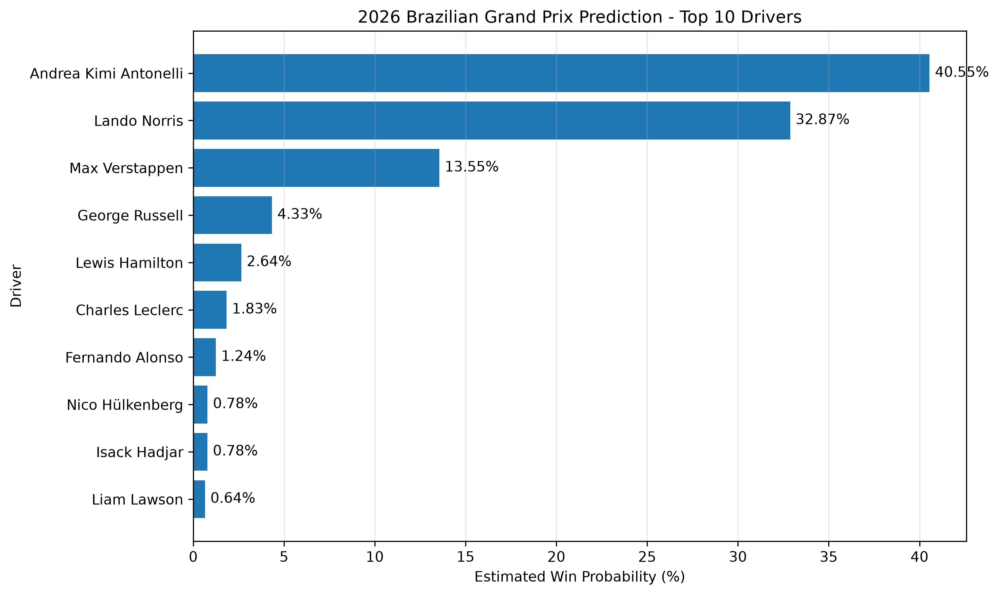

# 🏎️ Brazilian Grand Prix 2026: Machine Learning Winner Prediction

A machine learning project using historical Formula 1 data to predict the winner of the 2026 Brazilian Grand Prix.

## Project Overview

This project explores whether machine learning can predict Formula 1 race winners more accurately than simply choosing the driver starting on pole position.

I collected historical Formula 1 race and qualifying data, engineered performance features, trained a Random Forest classifier, and evaluated its performance using walk-forward validation.

## Dataset

Source: Jolpica F1 API

- Historical race results from 2018–2025
- 2026 race results available before the Brazilian Grand Prix
- Historical qualifying results
- Over 3,400 historical driver-race observations

## Machine Learning Model

Algorithm: Random Forest Classifier

Final prediction features:
- Grid position
- Recent driver form
- Recent team form
- Season wins
- Season win rate
- Recent points scored

## Model Evaluation

Walk-forward validation over 90 races (2021–2024):

| Model | Winner Prediction Accuracy |
|---|---|
| Random Forest | 55.56% |
| Pole-position baseline | 51.11% |

The Random Forest correctly identified the winner in 50 of 90 races, compared with 46 for the baseline.

These historical results used grid-position information.

## 2026 Brazilian Grand Prix Prediction

**Predicted winner: Andrea Kimi Antonelli (Mercedes)**

| Rank | Driver | Starting Grid | Model Win Score |
|---|---|---|---|
| 1 | Andrea Kimi Antonelli | 2 | 40.55% |
| 2 | Lando Norris | 1 | 32.87% |
| 3 | Max Verstappen | 21 | 13.55% |
| 4 | George Russell | 7 | 4.33% |
| 5 | Lewis Hamilton | 20 | 2.64% |

The model scores were normalised across drivers and should not be interpreted as independently calibrated win probabilities.

## Technologies Used

- Python
- pandas
- scikit-learn
- matplotlib
- requests
- VS Code

## Key Learnings

- Collecting and cleaning real-world data
- Feature engineering for predictive models
- Training Random Forest classifiers
- Walk-forward validation
- Comparing models against a simple baseline
- Evaluating model probabilities
- Visualising machine learning predictions

## Limitations and Future Improvements

- Relatively small historical dataset
- Some validation periods reused during experimentation
- Normalised prediction scores are not fully calibrated
- Future models could incorporate weather, circuit history and more detailed qualifying performance

## Data Source

[Jolpica F1 API](https://api.jolpi.ca/)
